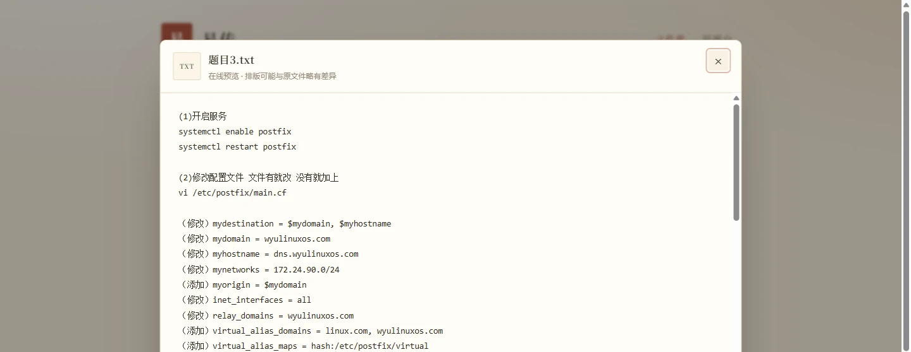
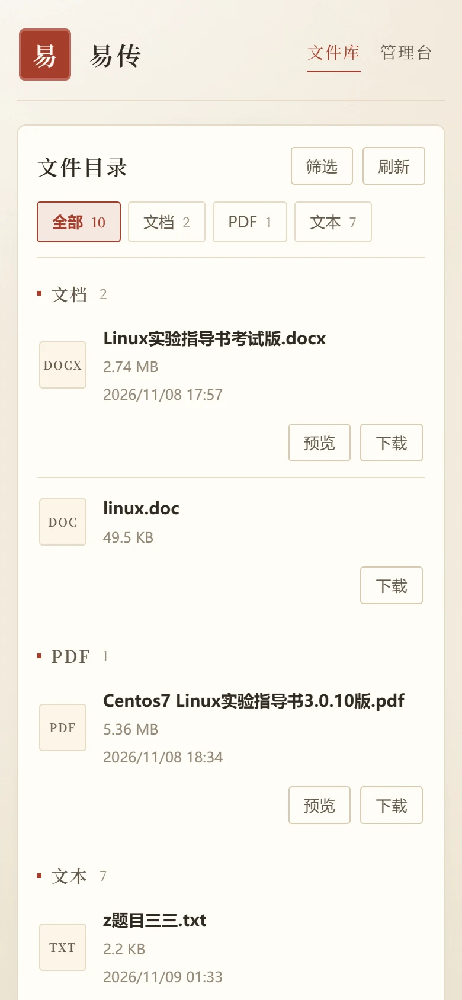

<div align="center">

# 📮 易传

纯前端、零后端的个人文档中转站 —— 把 GitHub 仓库当作文件存储，换一台电脑打开网页即可预览、下载。

[](LICENSE)
[](https://github.com/throne24/upload_files/stargazers)


[在线体验](https://throne24.github.io/upload_files/) · [快速开始](#快速开始) · [界面预览](#界面预览) · [部署指南](#部署与配置)

</div>

## 界面预览

| 文件库（桌面端） | 在线预览 |
| --- | --- |
|  |  |

| 管理台（桌面端） | 文件库（390px 移动端） |
| --- | --- |
|  |  |

## 为什么做这个

临时跨设备传文档，常见做法是登录网盘或发即时通讯，前者重、后者容易过期。这个项目把 GitHub 仓库当作文件存储，网站本身是纯静态页面：

- **上传、删除**：浏览器直接调用 GitHub Contents API，需要 Personal Access Token（只保存在当前浏览器的 `localStorage`）
- **浏览、预览、下载**：公开仓库无需登录、无需令牌
- **部署**：GitHub Actions 自动构建并发布到 GitHub Pages

## 功能

### 文件库（免登录）

- 按文档 / 表格 / 演示 / PDF / 文本 / 其他自动分类
- 关键词搜索，按最近更新 / 名称 / 大小排序
- 在线预览 TXT、MD、CSV、DOCX、PDF、XLS、XLSX；DOC、PPT、PPTX 仅下载
- 下载显示实时进度与速度
- 适配 390px 以上移动端

### 管理台（需令牌）

- 仓库设置：owner / repo / branch / 目录 / Token，支持一键测试连接
- 拖拽或选择文件，多文件顺序上传，队列中显示真实上传进度
- 同名文件二次确认后覆盖（基于 `sha`）
- 删除文件前二次确认

## 技术架构


网站自身不存储数据：文件列表就是目录 API 的返回结果，文件内容就是仓库里的文件。写操作携带令牌，读操作可匿名。

## 关键技术决策

| 问题 | 做法 | 取舍 |
| --- | --- | --- |
| `fetch` 拿不到上传进度 | 用 `XMLHttpRequest` + `upload.onprogress` 发送 PUT | 放弃 fetch 的简洁，换取真实字节进度 |
| 直连 GitHub 偶发缓慢或失败 | 下载按「公共加速镜像 → Contents API raw → `download_url`」三级回退，镜像 12 秒首字节超时（`AbortController`） | 提升弱网可用性，但依赖第三方镜像 |
| 同一文件反复下载 | `Cache Storage` 以 `owner/repo/sha/path` 为键缓存，写入时清理同路径旧版本；隐私模式或配额异常时静默回退网络 | 命中快且强一致，代价是占用本地存储 |
| 预览库体积大 | `mammoth`、`xlsx`、`dompurify` 在打开预览时才动态 `import` | 首屏包不含解析库，首次预览多一次加载 |
| DOCX / XLSX 转 HTML 后 `v-html` | 渲染前统一经 DOMPurify 清洗 | 防 XSS，代价是部分复杂样式被过滤 |
| 国内老文档编码混乱 | UTF-8 解码出现替换字符时回退 GBK | 解决乱码，非 UTF-8/GBK 编码仍可能异常 |
| 目录接口不返回上传时间 | 用 commits API 最近 100 条中 `上传文件：xxx` 的提交信息反推，失败返回空 Map | 不额外引入元数据文件，但网页外提交的文件没有时间 |
| Pages 子路径部署 | `vite.config.js` 使用 `base: './'`，运行时从 `用户名.github.io/仓库名/` 自动识别仓库 | 任意子路径可用，自定义域名需手动配置 |
| 上传文件会触发重新构建 | 部署工作流配置 `paths-ignore: files/**` | 只传文档时不浪费构建时间 |
| 文件库与管理台重复请求 | `useFileList` 状态提升为模块级单例，60 秒内复用缓存，刷新/上传/设置保存强制更新 | 切页不再重复消耗 API 额度，代价是数据最多滞后 60 秒 |

## 质量保障

- `pnpm test`：Vitest + happy-dom，6 个测试文件共 108 个用例，测试过程不访问网络
- `pnpm test:coverage`：`src/lib/**` 行覆盖率 97.74%，分支覆盖率 91.96%，并配置了 80% 的覆盖率阈值
- GitHub Actions 在构建前执行 `pnpm test:coverage`，测试或覆盖率不达标时不会部署
- 重点覆盖：下载三级回退与全失败、镜像首字节超时、上传/下载主动取消、上传超时、目录 404 与分支写错、HTTP 状态映射、GBK 回退、缓存写入与旧版本清理

## 快速开始

### 环境要求

- Node.js `^20.19.0` 或 `>=22.12.0`
- pnpm

### 本地运行

```bash
pnpm install
pnpm dev           # 本地开发
pnpm build         # 生产构建
pnpm preview       # 预览生产构建
```

### 单元测试

```bash
pnpm test          # 运行全部用例
pnpm test:coverage # 生成覆盖率报告
```

## 部署与配置

1. 新建一个 **Public** 仓库（GitHub Pages 免费账户要求仓库公开）
2. 创建 Fine-grained Personal Access Token：只授权该仓库，权限为 `Contents: Read and write`
3. 部署完成后打开网站，在「管理台 → 仓库设置」填入 Token
4. 站点部署在 `https://用户名.github.io/仓库名/` 时会自动识别 owner 与 repo；使用自定义域名时需修改 [src/site-config.js](src/site-config.js)

> 令牌只保存在当前浏览器的 `localStorage`，不会写入源码、构建产物或提交记录。设置只对当前浏览器生效，换设备需重新填写。

## 目录结构

```
src/
├── components/
│   ├── FileList.vue     文件列表容器、空状态与分组
│   ├── FileToolbar.vue  标题、搜索排序、筛选面板与分类条
│   ├── FileRow.vue      单行文件信息、下载进度与操作按钮
│   ├── UploadZone.vue   拖拽上传、队列与重试
│   ├── PreviewDialog.vue 在线预览弹窗
│   ├── SettingsDialog.vue 仓库设置与连接测试
│   └── ToastStack.vue   全局提示
├── composables/
│   ├── useFileList.js   列表加载、下载进度与删除
│   └── useFileFilter.js 搜索、排序与分类计算
├── views/               FilesView（文件库）/ ManageView（管理台）
├── lib/
│   ├── github.js        GitHub Contents API 封装、上传下载、错误映射
│   ├── config.js        仓库配置与 localStorage 持久化
│   ├── filetypes.js     扩展名、分类、预览与上传白名单
│   ├── format.js        文件大小、时间、下载速度格式化
│   ├── text.js          UTF-8 / GBK 文本解码
│   └── toast.js         全局提示
├── router.js
├── site-config.js       仅自定义域名部署时需要填写
└── style.css
tests/unit/              6 个测试文件，共 108 个用例
.github/workflows/       Pages 自动部署
docs/screenshots/        README 界面截图
files/                   仓库内的文件目录（网站的数据）
```

## 已知限制

- GitHub Contents API 对单文件大小有限制，且上传内容需 base64 编码（体积约增加 1/3），超大文件不适合此方案
- 文件存放在公开仓库中，任何拿到地址的人都能下载；私有仓库则必须提供令牌才能读取
- 下载优先使用公共加速镜像，属于第三方服务，可用性与隐私需自行评估
- 大文件预览依赖下载速度，弱网或镜像缓慢时首次打开需要等待
- 未认证的 GitHub API 限流为每小时 60 次；列表已做 60 秒缓存，频繁手动刷新仍可能触发限流，填写令牌可提高额度
- 令牌保存在浏览器 `localStorage`，存在 XSS 风险；已通过 DOMPurify 清洗预览内容、最小权限令牌缓解
- Markdown 目前按纯文本预览，不渲染排版

## License

本项目基于 [MIT License](LICENSE) 开源，版权归 throne24 所有。
